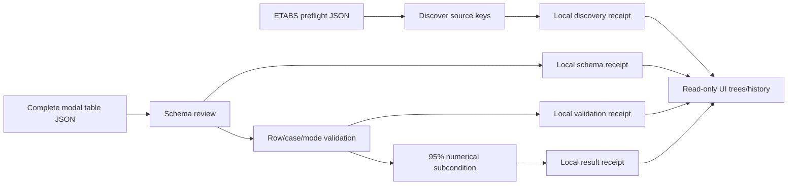

# TBDY Next Engine — product-owned architecture

This is a **new implementation**, not a rename of the prior runtime. Every adopted idea is reshaped to one small interface and documented in `REUSE_REGISTER.md`. Do **not** add another global 94-node runtime, GAP bureaucracy, or a second competing formula engine for VS01.

## Implemented stage graph

## Module ownership

- `source.py`: preflight discovery and factual modal row validation. No engineering verdict.
- `schema.py`: table-column discovery and suggested, **unapproved**, aliases.
- `modal.py`: pure, unitless TBDY 2018 §4.8.1.2 95% numerical subcondition.
- `receipts.py`: immutable local input archive and append-only per-run stage records.
- `etabs_modal.py`: project-owned, narrowly scoped ETABS v23 modal-row capture adapter.
- `live_etabs.py`: Windows-only COM lifecycle and single-process serial acquisition; never passes COM objects across HTTP request threads.
- `history.py`: reads and recalculates locally sealed input/receipt pairs for presentation, without opening ETABS.
- `cli.py`: bounded commands for VS01.
- `web.py` + `static/index.html` + `static/history.js`: localhost-only interactive UI, live single-click trigger, source/result tree and saved history. Live UI and CLI call the same `source.py` + `modal.py` validators.

## State meanings

| State | Meaning |
| --- | --- |
| DISCOVERED | Table key is listed by an attached ETABS session. |
| SCHEMA_FIELDS_PRESENT | Expected column names are listed; full row contents have not necessarily been checked. |
| SCHEMA_VALID | Full imported table passes VS01 row, modal-case, and cumulative-ratio validation. |
| MEETS_NUMERICAL_CRITERION | Selected modal case reaches 0.95 in both X and Y with recognized significant modes. **Not engineering PASS.** |
| DOES_NOT_MEET_NUMERICAL_CRITERION | Captured table is valid, but the selected case does not meet the numerical threshold. |
| REJECTED | Data or contract was invalid; receipt is retained locally. |

## Expansion discipline

One slice at a time: observe real ETABS schema -> validate fields and complete rows -> compute derived quantities -> apply one bounded rule -> persist result -> add UI panel. Every stage has tests and a local receipt. When existing schema is insufficient, perform a **targeted** live-ETABS or offline capture—not a full restart of schema/census research.

VS02: full modal case/source-basis interpretation; VS03: spectral response/base shear; VS04: column axial; later: second-order/PMM, shear, SCWB. No placeholders are promoted to executed checks.

## Full report contract (VS02)

`reporting.py` is a pure presentation/export boundary. It reuses the canonical
VS01 modal evaluator and VS02 geometry evaluator to compare results to the
existing archived receipts; it never evaluates a new formula. The complete
report includes all registered check instances, 100% of their element rows,
source table/field metadata, full raw source snapshot, material type facts and
receipt hashes. `GET /api/export-checks?run_id=...` returns full JSON;
`GET /report/print?run_id=...` returns print-ready standalone HTML. Both
require an exact existing verified five-check run ID. No ETABS API is called.
Browser PDF output uses the print command; it is not a separate regulatory report.
Future check slices must extend this shared report boundary, not create shadow
PASS/FAIL calculators. Sensitive model/source data stay on the local computer
until a person explicitly downloads and shares the export.
