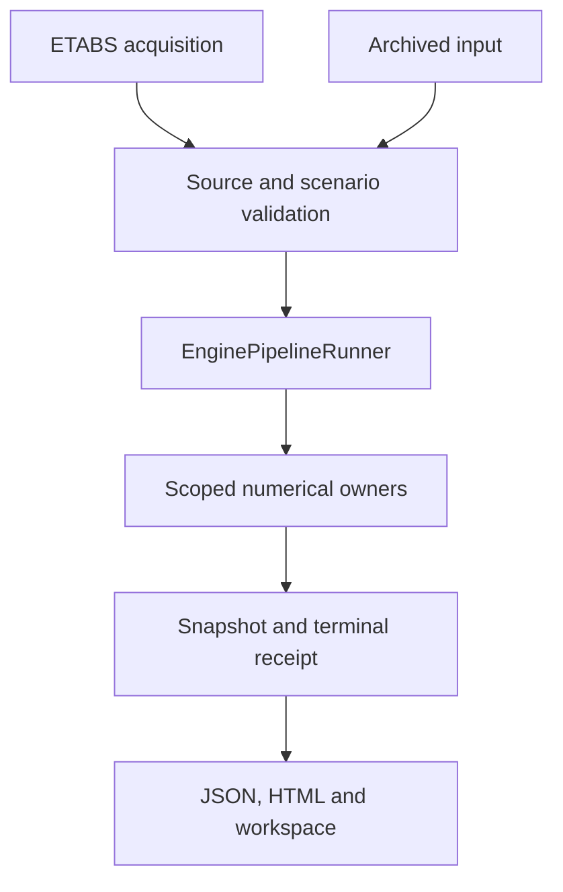
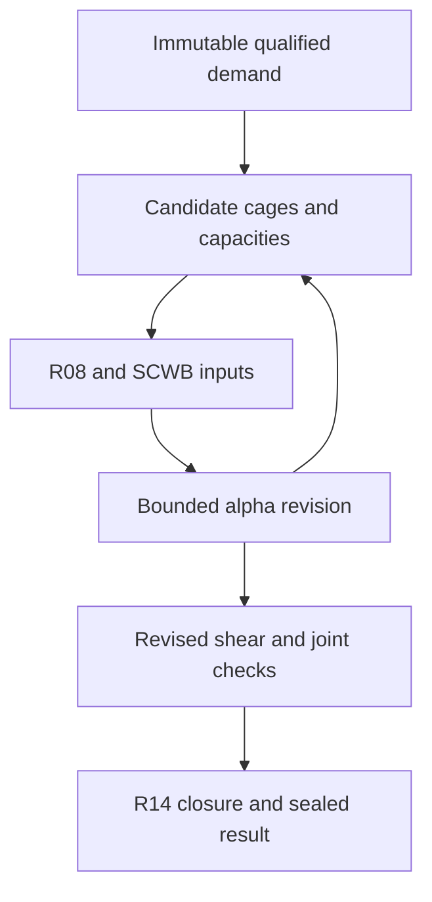

# YENI architecture — current implementation and evolution

**Implementation reviewed:** `c71a4dda4ab9453f428a38b3ed79931f8e6eeea3`, 21 November 2026. This document describes the current product and distinguishes planned changes. The repository-root [AGENTS.md](../AGENTS.md) governs work. Read the [system audit](supervisor/SYSTEM_AUDIT_20261121.md), [roadmap](supervisor/ROADMAP_20261121.md) and [audit evidence](supervisor/audit_20261121/README.md) for findings, acceptance experiments and current sprint assignments.

## 1. Product boundary and constitution

YENI is an offline-first ETABS postprocessor with one production runtime under `src/tbdy_next`. It acquires or replays analysis evidence, qualifies its meaning, executes bounded engineering calculations and records results for presentation. ETABS performs the structural analysis. The application must distinguish a native analysis result, a design-method assumption, a selected reinforcement candidate and an accepted design result.

The current implementation supports substantial column, beam-end, joint, story and source-validation work. It does not yet provide accepted complete design for every wall, slab, diaphragm, foundation or serviceability family. A navigation item, candidate rule or successful software test does not expand that boundary.

Retained architectural rules are:

- One production owner for each calculation and one existing ETABS acquisition route.
- Separate Physical, Analysis, Design and Result identities, joined explicitly.
- Declared units, axes, signs, case semantics and physical cuts at every boundary.
- Immutable source evidence; policy experiments create separate scenarios.
- Expected populations determined independently of successful calculation rows.
- Same-source demands and reinforcement revisions for dependent calculations.
- Explicit distinctions between execution, numerical condition, engineering qualification and release.
- Recorded results projected into reports; replay is a separate requested calculation.

Current code establishes implemented behavior. Applicable standards and qualified project/method decisions establish engineering requirements. Historical TBDY, Column and Column-Engine repositories are references; their branches, ownership rules and numerical conventions are not YENI runtime dependencies.

## 2. Responsibility tree

The filesystem is organized by adapters, numerical owners, integration and presentation. Physical connectivity is a graph, even where the user interface presents a tree.

| Responsibility | Current owner or module family |
| --- | --- |
| CLI and HTTP requests | `cli.py`, `web.py`, `engineering/cli_adapter.py` |
| Common production execution | `engineering/pipeline.py::EnginePipelineRunner` |
| ETABS session and native capture | `live_etabs.py`, `etabs_source_gateway_windows.py`, `frame_force_capture.py`, `basis_probe.py`, `diaphragm_probe.py` |
| Archived sources and native evidence | `column_engine/native_archive.py`, `source_bank.py`, `store.py`, `engineering/analysis_archive.py` |
| Physical stories, dimensions and faces | `physical_story_scope.py`, `story_geometry.py`, `column_engine/csi_geometry.py`, `engineering/column_clear_length.py` |
| Scenario lineage and dependencies | `engineering/design_scenario.py`, `design_dependencies.py` |
| Signed and spectral demands | `engineering/demand_sources.py`, `mixed_demands.py`, `column_engine/demand_types.py`, `spectral_envelope.py` |
| Section and detailing kernels | `column_engine/section_capacity.py`, `ts500_column.py`, `beam_capacity.py`, `scwb_kernel.py`, `transverse_kernel.py`, `joint_kernel.py` |
| Integrated member calculations | `engineering/column_axial.py`, `column_pmm.py`, `column_r08_local_live.py`, `column_r10_live.py`, `beam_r10_live.py` |
| Feedback and closure | `engineering/alpha_iteration.py`, `column_r14_closure.py` |
| Global and story checks | `modal.py`, `normative_basis.py`, `story_drift_binding.py`, `story_second_order.py`, `weak_story_b1.py`, `soft_story_b2.py` |
| Receipts and sealed results | `receipts.py`, `history.py`, `engineering/pipeline_snapshot.py` |
| Reports and UI | `reporting.py`, `static/workspace*.js`, `column.js`, `quick.js`, `engine-console.js` |
| Independent verification | `verification/golden_gate.py`, `report_oracles.py`, `verification/references`, `tests` |
| Candidate research graph | `compiled_dag.py`, `config/dag/tbdy_r1c_94_candidate.json` |

Shared frame topology currently comes from `column_r10_live._build_frame_catalog`. Its use by eight other modules is a known ownership problem: S09 should extract that existing behavior into a neutral geometry owner, preserve a compatibility delegate and demonstrate identical archived outputs. Do not create another frame model with different identity rules.

## 3. Four identity models

These are architectural responsibilities, not a claim that four complete class hierarchies already exist. Current enforcement combines immutable dataclasses, schema-tagged mappings, hashes and owner-specific validators.

| Model | Meaning | Identity and revisions |
| --- | --- | --- |
| Physical | Actual members, walls, stories, joints, supports, faces and connectivity | ETABS Unique IDs plus verified physical topology; story name is not an elevation |
| Analysis | Discretization, local axes, offsets, material/stiffness assignments, cases and solved response | Model/generation, object/element, case/step, station/side, source receipt |
| Design | Applicable rules, combinations, adopted method, candidate cage and design transformations | Versioned project/method basis, policy, cage and demand revisions |
| Result | Inputs consumed, intermediate values, capacities, decisions, scope and remaining conditions | Run, method, source, result and expected-instance identities |

One physical column can contain several analysis elements. Two faces at an internal joint remain distinct force sides. A new cage does not change the physical member ID, but it changes capacities and dependent checks. A source-file hash establishes byte identity; it does not independently establish that all responses belong to the claimed analysis generation.

`NativeCut`, `RecordedForceRow` and the native/local section-dimension types already implement parts of this boundary. Extend these contracts at existing adapters rather than introducing a parallel domain model across the whole repository at once.

## 4. Five graphs with different purposes

| Graph or tree | Purpose | Current implementation and limit |
| --- | --- | --- |
| Physical/model tree | Navigate building, stories, members, joints and analysis children | Geometry catalogs, connectivity and physical scope exist; wall/pier grouping remains incomplete |
| Normative applicability graph | Decide which rules apply to which physical subjects and project conditions | The 94-node research catalog and source prerequisites exist; general approval/applicability execution remains incomplete |
| Execution dependency graph | Schedule owners and bind consumed artifacts to producers | Common runner and partial contracts exist; sequence is still hand-written |
| Result tree | Present the same recorded values by check, member, case, cut and candidate | Sealed JSON/HTML and UI projections exist; complete catalog-wide instance accounting remains open |
| Run-state graph | Describe acquisition, execution, failure, finalization and replay transitions | Receipt sequence and terminal snapshot link enforce important transitions; this is not the normative DAG |

Do not collapse these graphs into one count. The current registry has **22 entries**, including evidence/finalization and compatibility modes. The research graph has **94 nodes and 140 edges**, with **30 nodes bound** to related registered stages and **64 unbound**. All candidate-node execution authority remains `DENIED`; bounded numerical owners can still run under their explicit contracts.

The 73 recipe labels, declared 242-rule legacy namespace, 44 golden comparisons and 37 workspace navigation rows are other populations. For example, B1/B2 calculations exist inside report evidence while their candidate nodes remain unbound. Neither `30/94` nor the number of visible panels is an engineering completion percentage.

## 5. Current execution flow

Both web and CLI prepare a source through the scenario boundary and call the same runner. Live acquisition uses the existing serialized COM lifecycle. Offline replay uses recorded bytes and does not require a live connection.

The current sequence is explicit Python control flow:

1. Modal/schema, optional geometry/material, analysis-source and story-drift checks.
2. Analysis setup, column axial population and same-source PMM/cut coverage.
3. Native/mixed-demand evidence and member/joint dependency plan.
4. Beam-end capacities, column candidate selection and initial R10 checks.
5. Same-run selected cages and the project seismic profile. The global second-order and effective-drift owners consume the model’s directional factors. The local R08 owner consumes its member and storey basis.
6. Bounded alpha iteration, revision evidence and R14/R15 closure.
7. Report evidence and, when requested, the `building-design` stage. Snapshot v3 stores its result directly and verifies its digest against the stage receipt. JSON, workspace and print read that result. Legacy v2 reports retain their original layout.

Initial R10 work supplies candidate and neighboring capacities needed by later calculations. Feedback must then recompute affected consumers using the current cage and demand revision.

The loop expresses dependencies, not an unconstrained retry. The existing alpha owner has explicit termination and unresolved states. Each iteration derives demands from immutable base effects and current absolute factors, avoiding cumulative re-amplification.

### Registry boundary

`engineering/frame_geometry.py` supplies the physical frame catalog shared by column, beam, story and joint owners. `engineering/seismic_profile.py` joins response cases to the assigned native TSC-2018 functions and resolves project classifications. The source-bound scenario records missing inputs entered through the web or CLI. The history catalog indexes navigation summaries. A receipt points to a verified, compressed, content-addressed blob for large source and result objects. Opening the calculation verifies the expanded contents.

`STAGES` documents owners, conditions, receipts and some typed artifacts; only seven entries currently declare input contracts. It does not dispatch the complete calculation as a topological scheduler. R14 has no dedicated `StageSpec`, and B1/B2/wall geometry execute within `derive_report_evidence`. Declared and actual ordering are not identical everywhere.

S09 should make the **existing supported chain** observable and registry-driven: explicit callable, applicability, inputs, outputs and execution trace. It must not turn research catalog bindings into automatic normative approval or attempt a wholesale 94-node rewrite.

## 6. Units, force meanings and transformation ownership

Section kernels use **N–mm–MPa**. Analysis boundaries use explicitly named **kN, m and kNm** fields. The current connection policy selects kN/m/C, ETABS API code 6. Temporary output selections are restored and verified. Conversion belongs at a named adapter, once; magnitude or a historical convention cannot select units.

Keep native CSI components and axes. Compression-positive section demand uses the verified `N = -P` conversion. M2 and M3 use the corresponding physical local dimensions, not a second rotation of already-local geometry. Face transfer must include the required coordinate/reference transformation and loads between cuts.

Distinct supported meanings include:

- **Signed static state:** one compatible source, case, step, cut and six-component response.
- **Spectral component envelope:** independent scalar bounds with modal/directional provenance.
- **Code design candidate:** a declared construction from qualified inputs, such as permitted envelope corners.
- **Capacity-design demand:** a quantity derived from the current selected reinforcement capacities.

`PhysicalStaticForceState`, `SpectralComponentEnvelope` and `CodeDesignDemandCandidate` encode important distinctions. Matching component extrema does not establish a simultaneous physical vector. Global P–Delta, local P–delta, spectrum scaling, overstrength and alpha amplification remain different transformations; the selected method must prevent duplicate application.

## 7. Expected populations, failures and result states

Expected instances must be frozen before examining successful results. The necessary grain differs: member–combination–cut–side–axis, joint–direction–end, story–direction or another rule-specific subject. Include method and candidate revisions where they affect the result.

Axial and PMM ledgers already enumerate important scopes. Member dependencies allow independent columns to proceed while incomplete neighbors block the affected joint/story. General catalog-wide accounting remains incomplete. A missing source, rejected coordinate or failed check must not erase its physical obligation or reduce the denominator. A `NOT_APPLICABLE` result requires its applicability evidence.

Separate four questions: did the owner execute; what numerical condition was found; are source and method qualified; is the required product scope accepted? A local proven failure must remain visible even when whole-building qualification is incomplete. Current report-level `NOT_READY` is not permission to hide a subordinate `FAIL`.

S00 addresses the reproduced signed-elevation and conditional-equilibrium eligibility defects. A balance is proven inconsistent only after complete contributor coverage, compatible state and independent external loading are established. Missing wall contributors instead leave the full balance unresolved. Preserve that distinction when retaining the explicit conditional frame calculation.

## 8. Revisions, sealing and replay

`design_scenario.py` retains original parent bytes and binds selection policies and calculation assumptions to a separate scenario. `design_dependencies.py` records demand, cage, R08, beam-end, SCWB, alpha, shear and R14-input revisions. Its current implementation reruns eligible owners; **persistent design-cache reuse is not implemented**.

`pipeline_snapshot.py` binds input, method fingerprint, registry, results and stage inventory. Finalization requires the matching terminal receipt. Current v2 reports project these sealed outputs; tests explicitly prohibit invoking design solvers during report export. Legacy recomputation remains a separately labelled compatibility route.

Replay creates a new run. Comparison reports source, stage and method differences rather than claiming historical equivalence. Changed upstream geometry, generation, demand, cut, cage or method must invalidate affected downstream evidence. S09 can improve granularity without relaxing this rule.

The receipt writer currently permits a three-digit index while readers match two digits. The audit reproduced 100 written/99 loaded. S00 must repair and verify that boundary before a larger execution plan expands receipt counts. The recorded 16-receipt C29 run is unaffected.

## 9. Full-building scope and evolution

| Domain | Current boundary | Remaining complete slice |
| --- | --- | --- |
| Columns, beam ends and joints | Integrated numerical owners, conditional C29 result and selected-cage feedback | Coupled members, independent full-method validation and complete detailing |
| Global seismic and irregularities | Modal/spectrum, drift and conditional A1/B1/B2 work | Complete applicability/scaling and A2/A3/B3 physical scope |
| Walls and piers | Ordinary panel geometry and story-force input contracts | Physical grouping, axial/flexural/shear capacity, boundary reinforcement and coupling |
| Diaphragms | Source/mass/modal linkage | Collectors, chords, force transfer and connections |
| Slabs | Source metadata and candidate/UI entries | Flexure, shear, punching, reinforcement and serviceability |
| Foundations | Support evidence for column calculations | Soil/contact, flexure, shear, punching and foundation detailing |
| Beam serviceability/torsion | Explicit open limits | Qualified SLS combinations, crack/deflection, torsion and associated reinforcement |

Foundation support qualification is not foundation design; a wall panel is not automatically a complete physical wall. S11–S15 expand these full-building domains through independent vertical slices. Each must identify its applicable rule, physical population, source contract, numerical owner, independent example and sealed consumer result.

The immediate order is **S00 correctness**, continuation of the qualified physical calculations, and **S09 architecture integration** alongside the roadmap’s engineering dependencies. Preserve completed C29 evidence as a regression anchor. Update this document when ownership or execution changes; keep historical runs and test counts in their dated ledger records.
