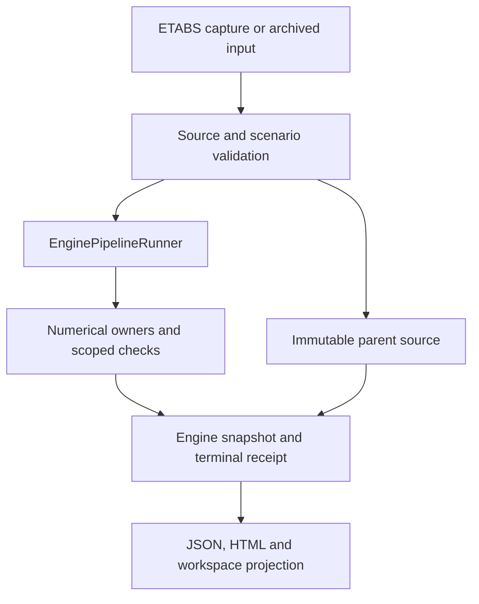
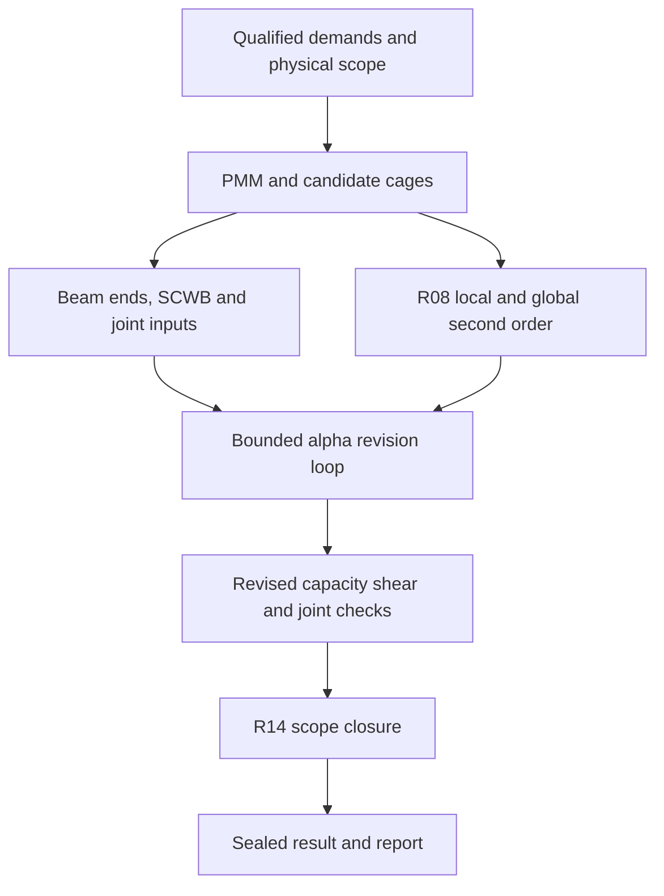

# YENI architecture, execution and product-scope audit

**Inspected baseline:** `c71a4dda4ab9453f428a38b3ed79931f8e6eeea3`, initially clean tracked worktree. The audit read actual source and tests, imported the current production registry and candidate catalog, and ran one bounded receipt-index API diagnostic. No full regression, live ETABS run, private C29 replay or engineering acceptance was performed in this audit lane.

## 1. Executive assessment

The current product has a real common execution owner and significant working numerical slices. It is no longer accurate to describe it as merely disconnected helpers or an inert UI. Both web and CLI reach `EnginePipelineRunner`; same-run selected cages, local/global second order, PMM, beam/column capacity shear, joint checks, alpha feedback, revision evidence, R14 closure and finalized reports have production owners. Source-bound immutable receipts and projection-only v2 reports are substantial architectural strengths.

The main architectural gap is that the **descriptive stage registry, hand-written execution sequence, candidate normative DAG and complete physical check population remain different mechanisms**. This is explicit technical debt, not an argument for another repository or solver. A future worker should finish the contracts for the currently supported calculation chain, then grow whole-building families through that chain. Converting all 94 research nodes into executable checks before completing one accepted physical design example would repeat the original failure mode.

The broad product also lacks complete design owners for several major families: physical wall/pier design, slabs/punching, foundations/geotechnical checks, diaphragm force transfer, beam torsion and serviceability. The existing 18 GAPs primarily organize the column-centered recovery path; they are not a complete implementation list for the full building product.

## 2. Measured inventories — do not mix their denominators

The read-only inventory is in [ARCHITECTURE_INVENTORY.json](audit_20261121/ARCHITECTURE_INVENTORY.json).

| Inventory | Current observation | Interpretation |
| --- | ---: | --- |
| Python source files under `src/tbdy_next` | 139 | Includes verification/reference modules; not engineering check count |
| Python source lines | 44,427 | Size, not correctness or completion |
| `STAGES` entries | 22 | 20 live-source entries including evidence/finalization, one archived scenario, one offline bank |
| Entries declaring `consumes` | 7 | Typed dependency contracts cover a pilot subset |
| Entries declaring `produces` | 11 | An artifact declaration is not complete shape/semantic validation |
| Candidate DAG nodes/edges | 94 / 140 | Static research catalog; 16 source gates, 10 derivations, 32 regulatory checks, 36 design checks |
| Catalog nodes bound to registry entries | 30 | Related evidence owner exists; not engineering PASS |
| Unbound candidate nodes | 64 | Includes both unimplemented families and implemented checks hidden in report-evidence |
| Authorized candidate DAG nodes | 0 | Execution authority remains DENIED by design |
| Imported recipe mappings | 73 | 5 source labels + 68 engineering labels; historical 44 partial bindings / 29 unmapped |
| Declared legacy atomic namespace | 242 | A distinct inherited candidate-rule namespace, not 242 implemented owners |
| Production rule-card records | 27 | Another distinct population |
| Golden comparison records | 44 | Current supplied software evidence: 36 numeric, 4 interpretation, 4 insufficient-source |
| Workspace navigation | 37 rows / 8 groups | Includes source views and unfinished design families |
| Latest C29 recorded run | 16 sealed stages | Run-specific receipt count, not 16 total product checks |

**Why a completion percentage would be misleading:** B1 and B2 are computed by `derive_report_evidence`, yet `WEAK_STORY_B1` and `SOFT_STORY_B2` remain unbound in `dag_coverage`. Conversely, an item appearing in the 37-row UI does not establish an executable wall, slab or foundation design. The 44 partial recipe bindings are unrelated to the 44 golden comparisons.

Evidence: `engineering/pipeline.py::STAGES`, `stage_registry`, `dag_coverage`; `compiled_dag.py::validate_candidate_catalog`; `static/workspace.js::groups`; `engineering/column_gates.py::NAMESPACE_RECONCILIATION`; `docs/engineering/reference/recipe_20261118/delivery/CHECK_MAPPING.json::counts`.

## 3. Actual module tree and responsibilities

| Layer / branch | Existing modules | Current role |
| --- | --- | --- |
| Application entry | `cli.py`, `web.py`, `engineering/cli_adapter.py` | User requests, archive/replay entry, web endpoints; common execution owner |
| Native source access | `live_etabs.py`, `etabs_source_gateway_windows.py`, `frame_force_capture.py`, `basis_probe.py`, `diaphragm_probe.py` | COM session/selection/unit transactions and native capture |
| Native/offline evidence | `column_engine/native_archive.py`, `source_bank.py`, `store.py`, `engineering/analysis_archive.py` | Immutable recorded facts, archive checks and legacy bank views |
| Geometry and identity | `etabs_geometry.py`, `story_geometry.py`, `physical_story_scope.py`, `column_engine/csi_geometry.py`, `engineering/column_clear_length.py` | Native/local dimensions, object/element identity, physical stories and faces |
| Scenario and dependency ownership | `engineering/design_scenario.py`, `design_dependencies.py`, `pipeline.py` | Explicit adopted calculation basis, cage policies, per-member/joint dependency closure |
| Demand construction | `engineering/demand_sources.py`, `mixed_demands.py`, `column_engine/demand_types.py`, `spectral_envelope.py`, `spectral_design.py` | Signed states, component bounds, linear combinations, modal/directional provenance |
| Section and detailing kernels | `column_engine/section_capacity.py`, `ts500_column.py`, `beam_capacity.py`, `scwb_kernel.py`, `transverse_kernel.py`, `joint_kernel.py` | Numerical owners, with explicit units and limited scopes |
| Building/member integration | `engineering/column_axial.py`, `column_pmm.py`, `column_r08_local_live.py`, `column_r10_live.py`, `beam_r10_live.py`, `alpha_iteration.py`, `column_r14_closure.py` | End-to-end selected member and story calculations |
| Global/source checks | `modal.py`, `normative_basis.py`, `story_drift_binding.py`, `story_second_order.py`, `weak_story_b1.py`, `soft_story_b2.py`, `wall_geometry.py` | Modal, spectral/drift, irregularity and wall geometry scopes |
| Persistence/reporting | `receipts.py`, `history.py`, `engineering/pipeline_snapshot.py`, `reporting.py` | Input archive, checksummed receipts, finalized snapshots and report projection |
| Product presentation | `static/workspace*.js`, `column.js`, `quick.js`, `engine-console.js` | Source/result views, selected candidate summaries and bounded diagnostics |
| Verification | `verification/golden_gate.py`, `report_oracles.py`, `verification/references`, `tests` | Production/reference comparison and software contracts |
| Research catalog | `compiled_dag.py`, `config/dag/tbdy_r1c_94_candidate.json`, recipe delivery | Candidate mapping and denied-authority coverage; not another solver |

Names alone can look duplicated, but `engineering/column_pmm.py` integrates native sources whereas `column_engine/section_capacity.py` owns the section solver. Numerical reference kernels under `verification/references` are intentionally independent verification assets. Do not delete these simply to reduce file count.

## 4. Actual flow

### 4.1 Source to immutable result

`web.py::_run_source_payload` and `engineering/cli_adapter.py::_run_pipeline_replay` prepare the source before calling the same runner. `PreparedPipelineSource` retains the original parent bytes. `create_design_scenario` rejects source mutations disguised as selection-policy changes, mismatched parent hashes, nested scenarios and unbound calculation assumptions.

### 4.2 Column-centered production calculation

The actual hand-written sequence in `run_source_pipeline` is approximately:

1. Modal/schema checks; optional geometry/material and VS04 source calculations.
2. Story drift and analysis setup/generation reconciliation.
3. Column axial population and combination checks, followed by selected-source PMM and independent cut census.
4. Native/mixed demand evidence, then member/joint dependency plan.
5. Beam selection/end capacities and initial column R10 selection/SCWB/shear/joint work.
6. Same-run selected-cage ledger and global second-order source calculations.
7. R08 local slenderness, adopted EI/K/Rm and selected-section magnification/PMM.
8. Bounded alpha iteration; changes rerun affected owners from the original demand basis.
9. Revision evidence and R14/R15 closure projection.
10. Report evidence, complete snapshot and terminal `live-capture` receipt.

This explains why R10 appears before final R08 and alpha: the initial cage and neighboring capacities must exist before the final coupled design loop can be evaluated. It is not a license to reuse first-order shear or an earlier cage after an alpha change. `build_revision_evidence` records that dependency and R14 blocks unresolved feedback.

The diagram expresses dependency intent; the current code still executes through explicit Python calls rather than a generic scheduler.

## 5. What is structurally sound and must be retained

1. **Common runner exists.** Web and CLI do not maintain competing full production calculation sequences. Evidence: `web.py:87–89`, `engineering/cli_adapter.py:42–88`, `engineering/pipeline.py:824–841`.
2. **Reports do not silently rerun current design solvers for v2 runs.** `build_complete_report` reads the sealed snapshot. `test_new_report_reads_sealed_design_results_without_running_design_solvers` patches every relevant solver to raise and still exports the report. The legacy recomputation branch is separately identified. Evidence: `reporting.py:561–582, 589–799`, `tests/test_pipeline_unification.py`.
3. **Snapshots bind source, methods, registry and results.** Finalization checks input hash, complete result keys, stage inventory and terminal link. Method fingerprint is content based. Evidence: `pipeline_snapshot.py:32–132`.
4. **Member-local progress and complete joint denominators coexist.** A bad member does not block every independent column, but an absent adjacent column/beam still blocks the affected joint and story. Evidence: `design_dependencies.py:77–204`, `tests/test_design_member_dependencies.py`.
5. **Candidate revision propagation exists.** Demand → cage → R08, beam end → SCWB → story alpha → Ve → R14-input dependencies are hashed; stale/cross-source artifacts are rejected. Current design cache reuse is explicitly false. Evidence: `design_dependencies.py:298–449`.
6. **Force semantics have meaningful immutable types.** `RecordedForceRow`, `PhysicalStaticForceState`, `SpectralComponentEnvelope` and `CodeDesignDemandCandidate` distinguish static concurrency from constructed spectral corners. The envelope retains its native lineage and never claims concurrent six-component response. Evidence: `column_engine/demand_types.py`.
7. **Native/local section dimensions are separated.** `NativeSectionDims` and `LocalSectionDims` prevent double conversion. Section kernel uses N–mm–MPa; native demand boundaries use explicitly named kN/m/kNm fields. Do not revive a historical kN–cm convention from another repository.
8. **Known failures are retained in subordinate result blocks.** Axial gates can explicitly return `FAIL`/`LOCAL_FAIL_PRESENT` even though the unqualified whole-building release remains `NOT_READY`. Do not weaken this separation when adding a generic status enum.
9. **Session ownership is real.** `live_etabs._with_etabs` initializes and releases COM on the calling thread and serializes acquisitions with a process-local lock. The gateway follows the existing unit/selection contract. No new COM attachment route is needed for architecture modernization.

## 6. Findings and priority

### A-01 — P1: Registry is not yet the executable source of the calculation graph

`STAGES` declares owner names, dependencies and conditions, but `run_source_pipeline` invokes the owners manually. `_validate_dependency_contracts` validates declared order, not the complete actual call trace. Only seven entries have input contracts. R14 closure is executed at lines 776–785 without a corresponding `StageSpec`; B1/B2 and wall geometry are calculations inside `report-evidence`. The declared order of design-dependencies and mixed-demand-components differs from their actual execution order.

**Impact:** expanding the runtime can create a stale registry, incomplete observable stage inventory or untracked dependencies. Existing numerical results are not thereby disproved.

**Exit:** bind the existing supported stages, including R14 and hidden checks, to explicit callables, applicability and source contracts; capture an execution trace generated by those same stage definitions; compare the trace, artifact set and numerical outputs with the current runner. Keep the candidate 94-node authority separate from execution of accepted bounded numerical stages.

### A-02 — P1: Full expected-check ledger is still a pilot, not catalog-wide

Axial and PMM independently enumerate member/combination/cut populations, and design dependencies freeze member/joint/story scopes. There is no generalized production `ExpectedCheckInstance` census for every full-building family. Candidate compiler accepts caller-declared instances but denies authority and is not the production scheduler.

**Impact:** a UI row, registered stage or resolved formula can be mistaken for full physical coverage; unmatched/unsupported families remain difficult to aggregate.

**Exit:** extend the existing expected-instance owners to a common record carrying rule/method, model generation, physical subject, case/operator, cut and side, direction, candidate revision, applicability evidence and reason. Expected scope must precede successful outputs. Begin with the current column/beam/joint chain, not all 242 legacy rule labels.

### A-03 — P1: Foundational geometry ownership sits inside a high-level column adapter

`column_r10_live.py::_build_frame_catalog` is a shared geometry/topology producer imported by eight other modules (nine import sites), including `gravity_story_basis`, `column_effective_length`, `scwb_axial`, `column_axial_balance`, `design_dependencies`, `alpha_iteration`, `story_static_reference` and `beam_r10_live`.

**Impact:** basic physical topology depends on a 2,496-line high-level column design module. This increases import coupling and makes changes in R10 riskier than their physical scope suggests.

**Exit:** extract the existing implementation unchanged into a small common geometry/topology owner, retain a temporary compatibility delegate, then migrate each caller. Compare the exact catalog/point/adjacency outputs on archived sources before altering any physical logic. This is a bounded extraction, not a new solver.

### A-04 — P1: Product-scope backlog extends beyond the current column recovery GAPs

The 94-node catalog includes wall/pier, diaphragm, slab, foundation and serviceability families that lack full production owners. Their appearance in navigation or research mappings can conceal the size of the remaining product.

**Exit:** maintain a product-domain matrix separate from the 18 current GAPs and identify release scopes explicitly: supported column-frame product; complete wall-frame superstructure; slabs/diaphragms; foundations/geotechnics; serviceability/performance as applicable. Each new family must have a complete vertical slice, independent scope, numerical oracle and sealed report before broader rollout.

### A-05 — P1 documentation: Architecture entry document is stale

`docs/ARCHITECTURE.md` still describes VS01/VS03 entry points, a modal-focused graph, early five-check reports and future stages already implemented. It is linked by the current project charter. `CURRENT_STATE.md` contains 1,187 lines and the handoff 452 lines; important current facts coexist with many historical checkpoints.

**Impact:** a fresh worker can reconstruct an older product and redo completed work, while a current architecture decision is spread across several historical files.

**Exit:** replace the architecture landing content with the actual owner map and current supported flow, retain earlier documents as dated history, and put one short checkpoint at the top linking the immutable evidence ledger and active sprint. Do not delete historical evidence or relabel its tests.

### A-06 — P2, reproduced: Receipt index only reads two-digit prefixes

`ReceiptRun.record` formats indices using `:02d`, which permits `100-...`; `pipeline_snapshot.read_receipts` and `history._read_receipt` glob exactly two digits. A temporary 100-record diagnostic wrote all 100 files but read only 99; `100-probe-100.json` existed and was omitted.

**Impact:** expansion to 100 or more stage receipts can omit records from inventory and break sealed finalization. The current 16-receipt C29 run is unaffected. This is not a demonstrated wrong engineering result.

**Exit:** parse a validated arbitrary-width numeric prefix and sort numerically, or explicitly limit the writer below 100 with a clear error. Before a broad scheduler expansion, cover 99/100/101, duplicate stage, invalid index and finalization behavior. Evidence: [RECEIPT_INDEX_PROBE.json](audit_20261121/RECEIPT_INDEX_PROBE.json), `receipts.py:42–43`, `pipeline_snapshot.py:54`, `history.py:26`.

### A-07 — P2: Monolithic reporting and high-level orchestration impede bounded review

Measured sizes: `reporting.py` 3,336 lines; `column_r10_live.py` 2,496; R08 adapter 1,095; web 849; pipeline 841. `workspace.js` is 1,404 lines, source presentation 931 and legacy column presentation 1,220.

**Impact:** mixed responsibilities increase review cost and stale UI/report mappings. Size alone does not establish a correctness defect.

**Exit:** after engineering source/owner boundaries stabilize, extract pure report presenters by family and shared frame topology; retain public adapters and snapshot schema during extraction. Do not simultaneously rewrite calculation kernels and presentation.

### A-08 — P1 acceptance design: Whole-product acceptance cannot be achieved by supplying more captures alone

Candidate normative authority is permanently denied in the current compiler; whole-report and UI contracts also require `NOT_READY`/`NOT_PROVEN`. This is a deliberate boundary, but a future qualified release requires a real acceptance evaluator and versioned approved project/method basis rather than editing status strings. Global release, per-check numerical condition and proven local failure are different fields.

**Exit:** establish a trusted, source-backed project/method decision record and scoped acceptance evaluator after the independent evidence is available. The evaluator should derive readiness from required instance coverage and accepted applicability, not from test count, user-set booleans or low PMM ratios. UI contracts must then support those legitimate states without erasing subordinate failures.

## 7. Full-building domain inventory

| Product domain | Existing implemented boundary | Remaining full-domain work |
| --- | --- | --- |
| Project/seismic profile | Native source observations and analysis-setup audit | Versioned applicable system/role/parameter decisions and scope acceptance |
| Modal/spectrum/base shear | Modal numerical check, captured spectrum reconstruction and conditional base shear/drift owners | Complete directional assumptions, scaling transfer and generation qualification |
| Irregularities | A1 observations, conditional B1/B2 numerical slices | Complete A2, A3, B3 topology/geometry and applicable full-population acceptance |
| Column PMM/local second order | Native signed cuts, selected cages, actual C29 conditional method, explicit unsupported branches | Independent full design acceptance, coupled members and complete load/cut/cage scope |
| Beam design | Candidate flexural bars/end capacity and capacity-shear consumers | Torsion/side bars, slab participation, full anchorage/continuity and general physical end topology |
| Beam-column joints | Selected neighboring capacity, SCWB and panel calculations | All end/direction/sign/cage populations and full anchorage applicability |
| Wall/pier design | `wall_geometry` checks rectangular panel ratio and ordinary minimum thickness; wall resultants can be consumed for story balance | Physical wall/arm grouping; net axial/flexural/shear capacity; boundaries/confinement; critical height; wall coupling and detailing |
| Global wall-frame stability | Story/second-order and conditional frame-column producer | Supported coupled two-axis stability method, full force balance and second-order demands |
| Diaphragm/collectors | Source assignment, mass and modal probes/linkage | Transfer forces, collector/chord demand, openings, reinforcement and connection design |
| Slabs | Source metadata and navigation/candidate nodes | Flexure, punching, shear, thickness, reinforcement, serviceability and required-cut topology |
| Foundations | Mat horizontal/rotational support evidence for columns | Soil pressure, contact/uplift, flexure, one-way shear, punching, ties, strip/isolated/raft design and geotechnical basis |
| Serviceability | No complete beam/slab crack/deflection owners identified | Separate SLS combinations, sustained-load stiffness/creep, crack/deflection limits and independent examples |
| Nonstructural/seismic separation | Candidate nodes | Applicable demands, components/connections and gap checks |

This is a source inventory, not a normative claim that every building requires every listed family. Applicability must be determined from the approved product/project scope.

## 8. Architecture work groups that unblock engineering workers

These AR groups describe technical work, not a competing sprint schedule. [S00 and S09 in the canonical roadmap](ROADMAP_20261121.md) assign their delivery and dependencies.

### AR-1 — Make the existing execution graph observable and complete

- Owner: `engineering/pipeline.py`, with current adapters unchanged.
- Deliver: one registry-backed execution trace for the currently supported column/beam/joint chain; explicit R14 and B1/B2/wall source checks; per-stage applicability and skip/block reason.
- Acceptance: web/CLI produce the same trace and sealed calculations; each output has one producer; every consumed artifact has a compatible preceding producer; absent data appears as a blocked expected stage. Preserve prior source hashes and numerical results under the same method.
- Dependency: current physics owners remain authoritative. Do not wait for all 94 nodes or invent authority for them.

### AR-2 — Unify expected physical instances across supported families

- Owner: existing axial/PMM ledgers plus `design_dependencies` and result projection.
- Deliver: a common record for member-combo-cut-side-axis, joint-direction, story-direction and rule applicability; a report denominator that includes unresolved required instances.
- Acceptance: omitted member, missing face, duplicate row, unavailable neighbor and UI filtering cannot reduce the denominator; a proven exception retains its source proof; full exported instance totals reconcile with the UI summary.

### AR-3 — Extract common frame topology and source identity types

- Owner: current `_build_frame_catalog` implementation and its callers.
- Deliver: neutral geometry owner; stable physical/analysis/design/result identifiers at adapters; keep existing NativeCut and dimension types.
- Acceptance: archived source catalog outputs are identical before/after extraction; changed geometry/generation/cage invalidates relevant artifacts; unrelated ready members can still run while affected joints block.

### AR-4 — Harden report/acceptance and expand one product domain

- Owner: snapshot/report layer plus selected engineering family.
- Deliver: receipt-index fix, family-specific presentation extraction, scoped accepted-result contract, and one new complete domain slice chosen from wall or diaphragm work.
- Acceptance: old sealed reports remain readable without recalculation; altered source/receipt/parent/terminal link is rejected; a supported accepted slice has a derived verdict while unimplemented required families remain explicit.

## 9. Worker operating rules derived from this audit

- Read current AGENTS and one current owner/evidence chain; do not rebuild from a historical architecture PDF.
- Open a sprint by naming its physical example, expected population, missing input or method decision and the consumer that must use the result.
- Treat a successful getter, schema, reference reconstruction or isolated formula test as an intermediate deliverable. Finish at a production result and sealed report when the sprint claims a calculation milestone.
- Run focused verification for the actual changed risk; reuse the known Linux/Windows whole-suite evidence until an implementation change needs a new integration gate.
- Keep research, source acquisition and implementation deliverables distinct, but assign explicit handoff contracts between them.
- Do not replace existing owners with success dictionaries in a positive integration test. Test contract guards separately from independent engineering validation.
- Preserve the completed C29 conditional example as a regression anchor while closing wall-frame force and stability work.
- Produce documentation updates only after reviewing their claims against source and evidence, then publish the verified milestone through the active integration branch.

Return to the [system audit](SYSTEM_AUDIT_20261121.md) and [canonical roadmap](ROADMAP_20261121.md).
