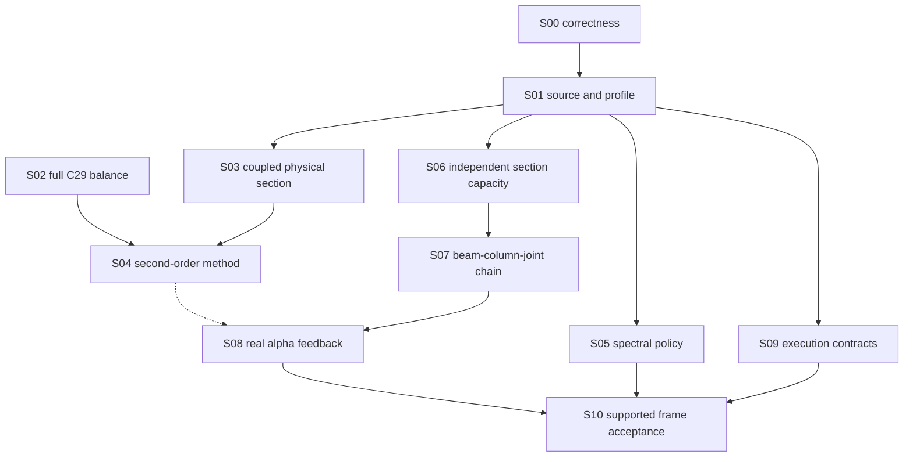

# YENI recovery roadmap and worker execution plan

**Audit baseline:** `c71a4dda4ab9453f428a38b3ed79931f8e6eeea3`, 21 November 2026. This is the canonical forward plan for the [system audit](SYSTEM_AUDIT_20261121.md). All S00–S15 work packages are **PLANNED / NOT RUN in this audit**. Historical runtime R00–R20 names and earlier sprint proposals are not renumbered by this plan.

**Progress update, 22 November 2026.** S00 and the six S02 balances reached their recorded scopes. S03 now has 12 balanced C104 first-order free bodies and 144 fixed mesh comparisons, including 16/72 passing components on the immediate transition faces. Next qualify the W22/W23 end transfer before adopting a coupled second-order demand. S06 completed the 24-face C29 selected-cage verification. Other PMM domains remain open. The [current calculation](../engineering/C104_TRANSITION_AND_C29_CAPACITY_20261122.md) and [active GAP task](../ENGINEERING_GAPS.yaml) carry the updated assignments. The [audit-time checkpoint](audit_20261122/WORKER_CHECKPOINT.json) preserves the earlier one-face stage.

**Latest role correction, 22 November 2026.** The user uses LC_EQX as the equivalent-static
reference for modal beta_tE scaling. The [role correction](LC_EQX_ROLE_CORRECTION_20261122.md)
supersedes an unconditional W22-first assignment: first trace actual design
combinations and required/applied spectral scale, then compare consumed quantities.
The local auxiliary-case M3 discrepancy alone does not establish a PMM dependency.
Preserve the earlier numerical diagnostic and activate further W22 experiments
when their relevance to used global or design quantities is demonstrated.

**Earlier supervisor review of a89f70f.** The [milestone review](C104_TRANSITION_REVIEW_20261122.md)
preserves these completed subscopes and supplies the then-proposed
[W22/W23 experiment plan](c104_review_20261122/W22_TRANSFER_PLAN.json).
Before new solves, qualify actual interface membership and equivalent physical
automatic-seismic forcing. Then compare both-side six-component actions and the
spatial first moment of vertical force. Two proposed cross-direction models
separate horizontal and vertical mesh effects if source inspection does not
resolve the change. They are not yet run and are not by themselves a convergence
proof. The historical S00/S02 assignment below must not restart completed work.

| Current lane | Next bounded delivery | Preserved result |
| --- | --- | --- |
| Native/source diagnosis | Actual case roles, equivalent/pre-beta modal shear, required/applied beta_tE and design-demand comparison | Twelve C104 balances; six C29 story balances |
| Offline integration | Trace assigned design consumers and scale ownership; extend transition/R08 only if a relevant interface experiment is needed | Current two-wall diagnostic and sealed report projection |
| Method research | S04 coupled second-order applicability with explicit EI, restraint, creep and axial variation | Conditional C29 factors and R14 2/87 |
| Independent capacity/design | S06 axial limits, other members/sections; S08 full-design example preparation | All 24 C29 faces completed; former remaining 23 no longer assigned |

## Delivery policy

Preserve the existing runner and completed native C29 work. Repair demonstrated defects first, finish source-qualified free bodies independently of coupled-method research, then qualify complete physical design slices. The 18 registered GAPs remain 3 OPEN and 15 PARTIAL. The whole-building product has additional missing domains; S11–S15 make those visible without inventing a false completion percentage.

`depends_on` means a final integration/acceptance artifact is needed. It does not prevent early source collection, analytical work, method comparison or oracle preparation. In particular S00, S02 and S04/S06 preparation can begin in parallel. The machine-readable [WORKER_PLAN.json](audit_20261121/WORKER_PLAN.json) and the [18 GAP recipes](GAP_EXIT_RECIPES_20261121.md) preserve exact owner/input/exit mappings.

The following lane table records the original 21 November assignment; use the
current lane table above for the next delivery.

| Lane | Original first delivery | Working rule |
| --- | --- | --- |
| Offline correctness | S00: datum, conditional failure eligibility and receipt indexing | One writer per affected module; real-owner regressions and archived impact report |
| Windows native evidence | S02: two exact-state C29 cut balances, then six case-cuts | Reuse valid solved generations; acquire only the missing facts through the existing gateway |
| Research and independent verification | S04 method candidates; S06 PMM inputs/oracle; S08 example qualification | Produce a distinguishing numerical experiment or counterexample and a decision record |
| Integration/supervision | Reconcile artifacts, scope and S09 contracts | No concurrent edits to shared calculation owners; review sources and numerical implications before publication |

No calendar completion dates are asserted. S00–S10 are bounded recovery packages that should be split further if their first physical example reveals additional scope. S11–S15 are domain milestones requiring their own short implementation sprints, each ending in a numerical consumer and sealed report. Estimate duration only after actual inputs and acceptance experiments are available.

## Dependency map

The diagram shows the principal frame-recovery dependencies; exact edges and the separate whole-building milestones are in WORKER_PLAN.json. The dashed S04-to-S08 connection is conditional on the selected benchmark entering the unresolved second-order domain, not a requirement to wait for all coupled research.

## Original first worker assignment — superseded by current progress

Read AGENTS, CURRENT_STATE, PROJECT_CHARTER, the active GAP/ledger and the handoff at the current remote head. Keep this audit's inspected SHA distinct from a later worker implementation. Start S00 on a scoped work branch. The audit bundle documents portable before/after commands. Use current private source locations from the local receipts; do not invent a new C29 fixture or assume a historical PID is still attached.

S02 can run alongside S00: capture the signed first-order wall rows for the existing two cuts, bind independent upper-body loads, and publish the U_F two-row balance before extending to TN_F/TP_F. Preserve conditional C29 factors and the wall-method gap as distinct results. S00 integration must not classify a balance residual as a proved physical contradiction until contributor completeness, exact-state identity and the independent load basis are all qualified.

At every handoff provide: source/model/generation/case/cut, required and evaluated counts, existing producer and consumer, numerical result with units, independent comparison/error budget, terminal reason, remaining scope, tests actually run, and the next bounded experiment. An unresolved result should explain which missing fact or rejected hypothesis determines the next action.

## Recovery sprint cards

### S00 — Repair reproduced source and receipt defects

**GAPs:** GAP-005, GAP-009, GAP-017. **Integration dependencies:** none.

**Environment:** Offline first; Windows only for the subsequent private native-C29 replay.

**Inputs**

- Current baseline and the two audit reproduction scripts
- Existing test_engine_r08_story, test_r08_story_second_order and test_gravity_story_basis inputs
- Sealed native C29 source/scenario for post-fix impact assessment

**Existing owners / integration points**

- engineering/story_pdelta.py
- story_second_order.py
- engineering/gravity_story_basis.py
- engineering/gravity_pair_refinement.py
- receipts.py
- history.py
- engineering/pipeline_snapshot.py
- web.py
- column_engine/store.py
- engineering/cli_adapter.py

**Work**

- Allow finite signed absolute elevations; retain positive height and other physical input constraints. Freeze the known story-direction denominator before numerical failure.
- Distinguish unavailable wall evidence from a complete, same-state, independently qualified balance that demonstrably fails. Propagate the latter to conditional consumer eligibility while retaining diagnostic numbers.
- Read variable-width numeric receipt prefixes and sort numerically; check duplicate indices and terminal-record selection. Cover 99, 100 and 101 records.
- Rerun the native C29 archive through the normal runner after the correction and report whether its supported results change.

**Exit criteria**

- Translated datum preserves theta and four expected instances. Invalid numerical input retains four unresolved instances.
- Missing wall evidence preserves the authorized conditional scenario; a qualified -100 kN balance contradiction cannot produce consumer-eligible factors.
- The complete reader/caller census accounts for records across the 99/100 boundary in numeric order, including web, store and CLI assumptions beyond the two probed readers.
- Native replay has an explicit before/after table; no assertion that a fixture proves original-building impact.

**Independent check:** Datum translation invariance; independent +100 kN imbalance in an existing complete fixture; actual 100-record writer/reader comparison.

**Decision/stop rule:** Do not broaden this repair into a new second-order method or rewrite the runner. A failed native replay is an accounted result requiring a scoped follow-up, not a reason to delete completed evidence.

**Deliverable:** Targeted regression changes, before/after probes, source hashes and one normal-runner C29 impact report.

### S01 — Qualify project profile, generation and required design scope

**GAPs:** GAP-001, GAP-002, GAP-003, GAP-004, GAP-005, GAP-007, GAP-008. **Integration dependencies:** S00.

**Environment:** Mostly offline source reconciliation; Windows for specifically absent native facts.

**Inputs**

- Project-adopted standard edition and amendments
- Native system, story/basement roles, mass, modifiers and analysis-case settings
- Required combination/family roster and actual source-generation evidence

**Existing owners / integration points**

- candidate_model_contracts.py
- engineering/analysis_setup.py
- engineering/mixed_demands.py
- engineering/design_assignments.py
- engineering/design_scenario.py
- engineering/pipeline.py

**Work**

- Create a field-level sourced/adopted/unresolved applicability matrix, including BKS/DTS/BYS and directional system parameters where relevant.
- Freeze required check/combination populations independently from captured or successful rows.
- Use existing recursive Linear Add expansion; classify unsupported operators and missing leaves rather than reimplement recursion.
- Challenge a contradictory source generation, wrong structural role and missing required combination through real consumers.

**Exit criteria**

- Every mandatory field has provenance or an explicit unresolved reason.
- Case/step/source identity survives capture, scenario and consumer stages.
- Missing and failed required instances remain in the denominator.
- No approval-shaped field alone enables global acceptance.

**Independent check:** Independent project worksheet and adopted primary clauses; controlled source-state changes; hand-expanded representative combination AST.

**Decision/stop rule:** Engineering assumptions that cannot be read from ETABS become named decisions with calculated alternatives; do not repeatedly query an API for construction intent.

**Deliverable:** Versioned model/profile and combination manifests consumed by the current runner, with known unresolved scope.

### S02 — Close the C29 full column-wall first-order balance

**GAPs:** GAP-009, GAP-004, GAP-008. **Integration dependencies:** none.

**Environment:** Windows native source lane, followed by offline integration. May start in parallel with S00.

**Inputs**

- Valid solved finest METHOD generation and C29G_U_F, then TN_F and TP_F
- Two physical cuts: +0.00 with 32 columns and 21 walls; +4.50 with 32 columns and four walls
- Independent upper-body applied loads and self weight; actual cut side, origin and axis definitions

**Existing owners / integration points**

- etabs_source_gateway_windows.py
- frame_force_capture.py
- engineering/gravity_story_basis.py
- engineering/gravity_pair_refinement.py

**Work**

- Read current installed API/output settings; acquire exact signed case/step rows and restore selections through the existing gateway. Do not assume the historical PID is still current.
- Transform point-element forces correctly to global axes, integrate the upper boundary once, and preserve every contributor identity.
- First publish both cuts for U_F; then extend to all six first-order case-cuts. Compare native section cuts as a second extraction path where available.

**Exit criteria**

- Both physical contributor censuses are complete and same-state qualified.
- All six case-cuts account for signed force, compression, external load and residual with existing abs=0.01 kN / rel=1e-6 isclose semantics.
- Missing rows are unresolved, never zero compression.
- Full free-body completion is reported separately from the unsupported wall critical-load method.

**Independent check:** Independent load/self-weight accounting and signed equilibrium; SectionCutAnalysis cross-checks extraction but is not an independent solver.

**Decision/stop rule:** If only Max/Min shell rows are available, resolve the setting/state issue instead of relabeling them Step 1. Do not rerun the completed 18 cases unless their solved generation is invalid or a bounded missing result requires it.

**Deliverable:** Six-row complete balance summary plus per-contributor lineage, sealed through the existing story consumer.

### S03 — Qualify C104 physical coupling and local section resultants

**GAPs:** GAP-006, GAP-015. **Integration dependencies:** S01.

**Environment:** Construction/detail review plus Windows controlled analyses and offline integration.

**Inputs**

- C104/W21/W22 geometry and frame-shell connections
- Two gross geometries across elevation -1.50 m
- Actual longitudinal/transverse reinforcement, anchorage and construction continuity
- Existing 50/25 mm matched mesh evidence

**Existing owners / integration points**

- engineering/column_clear_length.py
- column_engine/csi_geometry.py
- engineering/column_pmm.py
- engineering/column_r10_live.py
- engineering/column_r08_local_live.py

**Work**

- Decide and document which physical parts act as one reinforced section and which exchange forces as connected members.
- Integrate common physical section resultants in a common origin, including moment transfer r cross F.
- Separate mesh change, geometry change and material/EI change; study local transfer zones and both geometry regions.
- Keep all 14 coupled columns visible; do not reuse isolated clear-length capacity shear where not qualified.

**Exit criteria**

- Actual reinforcement/connection assumptions are sourced or explicitly adopted.
- Six resultants balance at defined cuts.
- Local governing demand and transfer quantities meet prespecified convergence budgets; frequency/base agreement alone is insufficient.
- The existing 73 standalone scope is preserved while the coupled scope is explicitly qualified or unresolved.

**Independent check:** Independent free-body integration and a reduced analytical model only within justified kinematics; construction drawings determine reinforcement continuity.

**Decision/stop rule:** Missing construction detail is a source/decision task, not a reason to run more COM getters. Do not treat every generated frame station as a physical section.

**Deliverable:** Physical section/connection contract for both geometries and a local-resultant convergence report.

### S04 — Choose and qualify the second-order method by domain

**GAPs:** GAP-009, GAP-016. **Integration dependencies:** S00, S01, S02, S03.

**Environment:** Research can start immediately; final integration uses qualified S01-S03 artifacts.

**Inputs**

- Source-compatible loads, geometry, stiffness, creep and support assumptions
- Every member/neighbor EI/L term and actual local-axis mapping
- Supplied TS500 edition and unresolved Eq.7.29 interpretation
- Actual variable-N and frozen Nmax cases

**Existing owners / integration points**

- engineering/gravity_story_basis.py
- engineering/gravity_deformation.py
- engineering/gravity_pair_refinement.py
- engineering/column_effective_length.py
- engineering/column_r08_local_live.py
- column_engine/ts500_column.py

**Work**

- Execute E09-B/C: direct matched first/second-order response and load-pattern-specific eigenbuckling with analytical limits and mode/mesh sensitivity.
- Derive any scalar system-to-story Nk mapping; if unsupported, calculate a bounded direct-demand alternative through current design owners.
- Source-bind every EI/L term or identify its adopted idealization.
- Execute E09-D/E: separate the narrow Nmax stability statement from signed response/PMM bounds; compute discriminating length and product/max interpretations.

**Exit criteria**

- The chosen route names its material, cracking, creep, slenderness, axial-variation and coupling domain.
- Eigenvalue times story Nd is not accepted as Nk without a demonstrated mapping.
- No double application of initial P-Delta and magnification; first/second analyses share the intended basis.
- All calculable candidates, their differences where comparable, and failed or unsupported scalar-mapping evidence are recorded. A qualified direct route can be reviewed without manufacturing Nk.

**Independent check:** Analytical member/frame limits, independent reduced model where justified, converged direct response, primary-code applicability and a branch-discriminating report case.

**Decision/stop rule:** A failed scalar mapping ends that hypothesis; it does not justify inventing wall Nk. Direct linear-material geometric response also must not be declared a complete nonlinear-material code method without qualification.

**Deliverable:** Versioned method decision and implemented consumer for its supported domain, with alternative results and remaining limitations.

### S05 — Resolve spectral scalar residuals and design-demand policy

**GAPs:** GAP-018, GAP-008. **Integration dependencies:** S01.

**Environment:** Offline reconstruction; Windows only for absent full-precision modal/torsion inputs.

**Inputs**

- Frozen 4,824 comparison population, 4,686 matches and 138 exceptions at 34 columns
- Original modal amplitudes, modes, damping, scaling and eccentricity definitions
- Physical cuts and exact generation identities

**Existing owners / integration points**

- engineering/demand_sources.py
- engineering/mixed_demands.py
- spectrum_reconstruction.py
- column_engine/spectral_envelope.py
- engineering/scwb_axial.py
- engineering/column_spectral_shear.py

**Work**

- Partition the 138 exceptions by mechanism and resolve one representative end to end before broad recapture.
- Recompute the whole fixed population without increasing tolerances to absorb unexplained error.
- Separately calculate an explicit sufficient-bound/envelope policy or compatible signed reference scenario for each design consumer.
- Demonstrate coverage of any continuous PMM search; interval corners alone are not a general proof.

**Exit criteria**

- All 4,824 controls remain accounted.
- Resolved precision or scaling mechanisms reproduce the relevant class.
- No scalar spectrum extrema are labeled physically simultaneous.
- Design-bound success, bound failure, physical failure and unresolved applicability have distinct meanings.

**Independent check:** Independent high-precision CQC/scale arithmetic, damping/orthogonal limits and static torsion equilibrium.

**Decision/stop rule:** Do not search for a unique simultaneous N-M-V state in Max/Min spectra: that information is absent. Unexplained cases remain explicit while proved narrower sufficient bounds remain usable.

**Deliverable:** Fixed-population residual ledger and a separately versioned design-demand policy with actual consumer examples.

### S06 — Qualify independent section capacity and cage/detailing inputs

**GAPs:** GAP-010, GAP-011, GAP-016. **Integration dependencies:** S01.

**Environment:** Offline independent numerical work; missing real drawings/report inputs may require source retrieval.

**Inputs**

- Actual bar coordinates, cover, materials and cage roles
- Matched N and moment direction for C29 and one complete reference example
- Strain/material laws and production section-method domain

**Existing owners / integration points**

- column_engine/section_capacity.py
- engineering/column_pmm.py
- engineering/rebar_selection.py
- column_engine/transverse_kernel.py
- verification/golden_gate.py
- verification/report_oracles.py

**Work**

- Use an independent strip/fiber integration, axial root and radial geometry implementation; do not call the production capacity owner from the oracle.
- Verify analytic limits, multiple relevant roots and spatial/angular convergence at fixed N and direction.
- Test the actual selected cage, not a same-area surrogate.
- Coordinate missing-source acquisition for the four goldens, but close only PMM_REPORT_GATE here. CAPACITY_SHEAR_REPORT_GATE belongs to S07; GOLDEN03/04 second-order report gates belong to S04/reference work. Preserve interpretation differences until adjudicated.

**Exit criteria**

- Prespecified capacity-unit tolerances are supported by residual and discretization estimates.
- Section equilibrium and ray admissibility are checked at domain boundaries.
- Shared constitutive assumptions are listed separately from implementation independence.
- Minimum/detailing constraints and section resistance remain distinct checks.

**Independent check:** Independent numerical implementation and analytic limits; matched OpenSees fiber experiment may supplement but does not establish TS500 material acceptance.

**Decision/stop rule:** A rounded report match or a broad regression tolerance is not an independent PMM error bound. Expand beyond the current section domain only with its own evidence.

**Deliverable:** Independent capacity comparison table, complete cage input evidence and one qualified section-method domain.

### S07 — Complete standalone beam-column-joint capacity chain

**GAPs:** GAP-012, GAP-014. **Integration dependencies:** S01, S06.

**Environment:** Offline using complete source and detailing inputs; targeted native reads only as needed.

**Inputs**

- Complete incident beams and columns at a real joint
- Actual beam longitudinal steel, anchorage, support faces and axial assumption
- Signed compatible demands and selected cages

**Existing owners / integration points**

- engineering/beam_r10_live.py
- column_engine/beam_capacity.py
- engineering/column_r10_live.py
- column_engine/joint_kernel.py
- column_engine/transverse_kernel.py

**Work**

- Compute actual signed end capacities and same-cut native Vd alongside capacity-derived Ve.
- Run transverse reinforcement and joint-panel checks with actual geometry and confinement/anchorage facts.
- Show a supported failure as well as a pass without losing incomplete neighbors.
- Progress standalone members first; couple wall-frame capacity shear only after S03/S04 and the relevant wall design contract.

**Exit criteria**

- All incident member endpoints are included or explicitly unresolved.
- Brittle limits and known failures survive other missing checks.
- No obsolete cage or first-order demand reaches final shear/joint consumers.
- Final numbers reach the normal-runner sealed report.

**Independent check:** Independent beam/column capacity, shear and joint worksheets with exact incident-member census and source-linked clauses.

**Decision/stop rule:** Beam N=0 and slab/anchorage contributions require an explicit applicable assumption; do not infer them from missing source fields.

**Deliverable:** One complete standalone column-beam-joint calculation chain, with supported scope and failure witnesses.

### S08 — Demonstrate nontrivial alpha feedback with real owners

**GAPs:** GAP-013, GAP-016. **Integration dependencies:** S06, S07.

**Environment:** Offline candidate preparation; native reanalysis only if the chosen revision invalidates source stiffness/geometry.

**Inputs**

- A complete real case with 0.70 <= alpha < 1
- Candidate: strongcol4.docx story 1, Vk/Vs 45.813/41.607 and 54.035/41.450; capacities and generation still need binding
- Original immutable demand, incident capacities and actual cages
- A qualified second-order method for this benchmark with source/stiffness/applicability identity; use an applicable standalone method. Require the relevant S04 artifact only if the example enters its coupled or unresolved domain.

**Existing owners / integration points**

- engineering/alpha_iteration.py
- engineering/design_dependencies.py
- engineering/column_r10_live.py
- engineering/beam_r10_live.py
- column_engine/story_alpha.py
- column_engine/scwb_kernel.py
- engineering/column_r14_closure.py

**Work**

- Compute alpha through real capacities; the report candidate gives about 0.908192 and 0.767095, not a preapproved new source.
- Apply the prescribed demand transformation exactly once from the original demand, then rerun selection, PMM, Ve, ties and joints.
- Record each iteration, source invalidation and convergence or exhaustion.
- Keep alpha=1 and alpha<0.70 as separate control/system-boundary cases.

**Exit criteria**

- No injected successful-stage dictionaries.
- At least one genuine downstream demand, utilization or cage decision changes.
- Replaying the same source cannot compound the factor.
- Nonconvergence and the alpha<0.70 structural-system consequence are reported explicitly.

**Independent check:** Independent joint/story force partition and end-capacity worksheet; visible before/after change in an actual downstream governing result.

**Decision/stop rule:** The original C29 zero-iteration outcome remains valid within its scope. If the report lacks capacities, acquire those exact fields or identify a separately named complete physical benchmark. Do not wait for the full C29 wall-frame method to verify an independently qualified standalone alpha example; do not bypass the chosen example's own second-order qualification.

**Deliverable:** Sealed before/after feedback example with all affected consumers and a transparent stopping reason.

### S09 — Align execution, required instances and sealed reporting

**GAPs:** GAP-005, GAP-017. **Integration dependencies:** S00, S01.

**Environment:** Offline architecture lane; coordinate module ownership with engineering work.

**Inputs**

- Actual runner sequence, 22 registry entries and candidate mapping
- Current supported physical/family census
- Recorded source/scenario/stage/report hashes

**Existing owners / integration points**

- engineering/pipeline.py
- engineering/design_dependencies.py
- compiled_dag.py
- engineering/pipeline_snapshot.py
- reporting.py
- engineering/column_r10_live.py

**Work**

- Expose R14 and hidden report-evidence checks in the registry without duplicating their calculation owners.
- Validate current consumes/produces against actual execution and retain unresolved required instances.
- Extract neutral frame topology from R10 with unchanged semantics and dedicated migration comparisons.
- Define the scoped acceptance-result contract and keep finalized report generation a pure projection.

**Exit criteria**

- Registry claims match invoked owners and artifacts.
- Every supported required instance has a terminal result/reason.
- Identical source/method produces equivalent sealed stage payloads.
- Neither node binding nor UI visibility is counted as engineering execution or approval.

**Independent check:** Recorded-run equivalence, deliberate missing/failing instance challenges, UI/CLI/report identity checks and source-to-result trace review.

**Decision/stop rule:** Do not introduce another 94-node runtime. Avoid changing geometry identities and engineering formulas in one patch.

**Deliverable:** Observable current execution graph, complete supported-instance ledger and source-compatible geometry ownership.

### S10 — Qualify and extend the supported frame design slice

**GAPs:** GAP-001, GAP-005, GAP-009, GAP-010, GAP-011, GAP-012, GAP-013, GAP-014, GAP-016, GAP-017, GAP-018. **Integration dependencies:** S04, S05, S06, S07, S08, S09.

**Environment:** Integrated offline/native replay under the declared source basis.

**Inputs**

- Qualified previous-sprint artifacts
- All 87 original columns and every required case/check instance
- Independent complete design example and scoped acceptance criteria

**Existing owners / integration points**

- engineering/pipeline.py
- engineering/column_r14_closure.py
- verification/golden_gate.py
- reporting.py

**Work**

- Complete one independently verified supported frame design before expanding the accepted domain.
- Account for all 87 columns; distinguish 73 standalone and 14 coupled rather than converting a selected subset to a building result.
- Expand only through qualified domain conditions and demonstrate UI/report/check-ledger agreement.
- Use a scoped acceptance evaluator with evidence and review, not a hard-coded READY edit.

**Exit criteria**

- Supported scope is independently verified end to end.
- All excluded/unsupported required members remain visible with reasons.
- Fresh full regression results identify environment, commit, logs and skip reasons.
- Whole-building acceptance remains unavailable while mandatory product families are absent.

**Independent check:** Complete independent design calculation using the same physical/source/cage identities.

**Decision/stop rule:** 73 proven lengths are not 73 accepted designs. A selected-column acceptance does not close full-building mandatory scope.

**Deliverable:** Reviewed supported-frame release candidate with complete instance accounting and independently checked numerical outputs.

## Whole-building domain milestones

These families extend the existing package and runner. They are not already implemented merely because a catalog or workspace row exists.

### S11 — Deliver full wall/pier and coupling-beam design

**GAPs:** GAP-015. **Integration dependencies:** S03, S04, S06, S09.

**Environment:** New domain implementation in the existing package; construction and native source evidence required.

**Inputs**

- Actual wall/pier/coupling-beam reinforcement and physical sections
- Qualified simultaneous or approved bounded demands
- Boundary-region, confinement and applicable system rules

**Existing owners / integration points**

- wall_geometry.py (geometry only)
- engineering/pipeline.py (integration)
- column_engine/section_capacity.py (reuse only within qualified domain)

**Work**

- Create the missing wall domain owner within YENI, with explicit axial-flexural, shear, boundary, confinement and coupling-beam responsibilities.
- Implement one real wall slice including geometry changes and adjoining column interaction.
- Add complete expected instances, independent capacity checks and a sealed report section.

**Exit criteria**

- Wall geometry screening is not relabeled wall design.
- Critical regions and actual reinforcement continuity are included.
- Brittle and ductile checks remain distinct with all required cases accounted.

**Independent check:** Independent complete wall/pier/coupling-beam calculation and physical reinforcement/detail review.

**Decision/stop rule:** Do not apply the current symmetric rectangular-column PMM domain to arbitrary composite walls without qualification.

**Deliverable:** First complete verified wall/pier slice, then a documented domain-expansion plan.

### S12 — Complete diaphragm transfer and remaining building irregularities

**GAPs:** Additional whole-building product scope. **Integration dependencies:** S01, S09.

**Environment:** Whole-building domain milestone; can proceed beside wall research.

**Inputs**

- Diaphragm constraints, openings, collectors/chords and transfer levels
- Applicable A2/A3/B3 and other required building checks
- Same-state floor/cut force and geometric evidence

**Existing owners / integration points**

- diaphragm_probe.py (source)
- physical_story_scope.py
- weak_story_b1.py
- soft_story_b2.py
- engineering/pipeline.py

**Work**

- Define missing physical diaphragm/load-path checks and their required instance population.
- Implement one force-transfer example with collectors/chords and opening/transfer applicability.
- Keep already implemented A1/B1/B2 scopes separate from missing irregularity rules.

**Exit criteria**

- Force transfer is checked, not inferred from a rigid-diaphragm assignment.
- All applicable irregularity instances are classified with evidence.

**Independent check:** Independent floor free body and clause-level geometry/applicability worksheet.

**Decision/stop rule:** An existing UI/catalog row is not a calculation owner. Introduce missing owners through the common runner only.

**Deliverable:** Verified diaphragm/transfer slice and an explicit complete irregularity applicability matrix.

### S13 — Complete slab and beam serviceability/design families

**GAPs:** Additional whole-building product scope. **Integration dependencies:** S01, S06, S09.

**Environment:** Whole-building milestone with bounded sub-sprints for slab, punching and beam SLS/torsion.

**Inputs**

- Slab geometry/supports/openings, reinforcement and applicable load cases
- Long-term cracking/creep assumptions and serviceability limits
- Beam torsion, side reinforcement, anchorage and actual support conditions

**Existing owners / integration points**

- engineering/beam_r10_live.py (existing beam capacity integration)
- column_engine/beam_capacity.py (limited existing capacity domain)
- engineering/pipeline.py

**Work**

- Add missing slab flexure/punching/serviceability owners with actual physical sections.
- Complete beam torsion/side reinforcement/anchorage and crack/deflection scopes as separate bounded cards.
- Use stated long-term stiffness and load assumptions; preserve construction versus selected reinforcement roles.

**Exit criteria**

- Each family reaches a normal-runner report and independent numerical comparison.
- Instantaneous and long-term deflection/strength checks remain distinct.
- Missing detailing and serviceability scope cannot vanish from building acceptance.

**Independent check:** Independent slab/punching and beam SLS/torsion calculations with analytical limits and matched physical examples.

**Decision/stop rule:** Treat this as a milestone to decompose after the first physical example is selected, not a promise to implement an entire slab/beam code in one short sprint.

**Deliverable:** Verified first examples and domain-specific acceptance matrices for the missing horizontal-member families.

### S14 — Deliver foundation and ground-interface design

**GAPs:** Additional whole-building product scope. **Integration dependencies:** S01, S09.

**Environment:** Whole-building milestone; geotechnical and construction inputs are essential.

**Inputs**

- Geotechnical design parameters and adopted combinations
- Foundation geometry, contact/uplift conditions, reinforcement and supports
- Qualified superstructure reactions and applicable soil-structure assumptions
- Applicable qualified flexure, shear and punching methods; consume the specific S11/S13 artifacts only where the chosen foundation requires them, without waiting for unrelated wall or beam-SLS completion.

**Existing owners / integration points**

- engineering/column_mat_support.py (support qualification only)
- engineering/pipeline.py

**Work**

- Implement ground pressure/contact/uplift and foundation flexure, punching and shear as explicit new domain owners.
- Distinguish superstructure end restraint from foundation capacity and geotechnical acceptability.
- Qualify one actual foundation example and then the supported foundation types.

**Exit criteria**

- Load combinations, contact domain and soil assumptions are explicit.
- Foundation and soil failure modes have independent results.
- Support qualification is never represented as completed foundation design.

**Independent check:** Independent geotechnical/contact and reinforced-concrete foundation calculations, including equilibrium and limiting cases.

**Decision/stop rule:** Start source/schema work in parallel; final acceptance needs qualified upstream reactions and domain methods. Missing geotechnical parameters cannot be inferred from ETABS labels.

**Deliverable:** First integrated foundation/soil-interface design slice and supported-domain statement.

### S15 — Independent whole-building acceptance and release

**GAPs:** Additional whole-building product scope. **Integration dependencies:** S10, S11, S12, S13, S14.

**Environment:** Controlled integration and independent engineering review.

**Inputs**

- Completed applicable domain owners and full required-instance census
- Versioned accepted profile, methods and design/cage revisions
- Independent building example and all material discrepancy decisions

**Existing owners / integration points**

- engineering/pipeline.py
- compiled_dag.py
- verification/golden_gate.py
- reporting.py

**Work**

- Run a complete independently checkable building example through the common source-to-report route.
- Reconcile physical source tree, rule applicability, dependency graph and result tree without disappearing required instances.
- Implement and exercise the scoped acceptance evaluator and review workflow.
- Freeze final source/method identities, full test logs, numerical differences and accepted limitations.

**Exit criteria**

- Every required instance is covered or has an accepted applicability exclusion.
- No unresolved mandatory numerical/source/method failure is hidden by a global flag.
- UI, CLI, exported report and ledger agree on scope and status.
- Release is a reviewed evidence result, not a test-count threshold.

**Independent check:** Independent complete structural calculation and review of source, methods, detailing and governing failure modes.

**Decision/stop rule:** Do not advertise complete building READY before mandatory wall/slab/foundation/diaphragm and other applicable families are qualified.

**Deliverable:** Reviewed engineering release for an explicit building/product domain, with reproducible evidence and remaining exclusions.

## Milestone review and scope discipline

The supervisor evaluates source identity, mathematical/numerical validity, code applicability, actual downstream consumption and result-population completeness separately. A passing unit test is evidence for its tested software contract. A report match is evidence for the reproduced report arithmetic. A native equilibrium is evidence for that qualified free body. None automatically proves the other dimensions.

Before merging an implementation milestone, show its actual numerical exit and changed dependent results, run relevant regressions and the required full integration gate where warranted, preserve old evidence IDs, and append an honest ledger record. Documentation-only work does not claim a new full suite. Normal Git publication uses a checked current head and no force overwrite of another worker.

For final method adoption, prepare both calculable candidates and their source/assumption/error comparisons first. The review decision is made on a concrete result. Open a follow-up only for the remaining exact uncertainty; do not leave the worker with a generic HOLD or another repository to rebuild.
